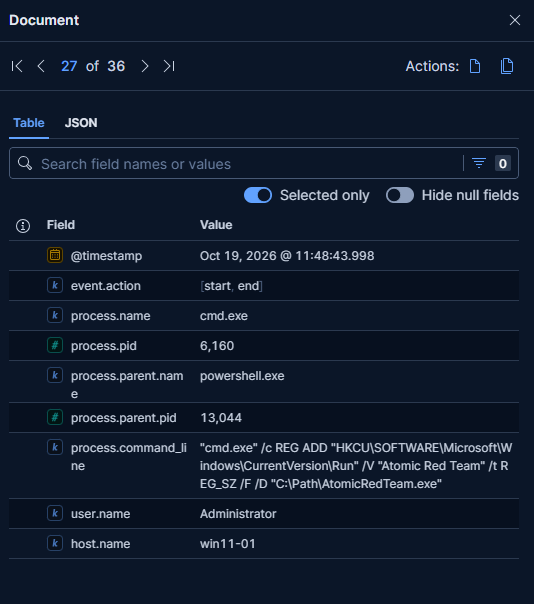
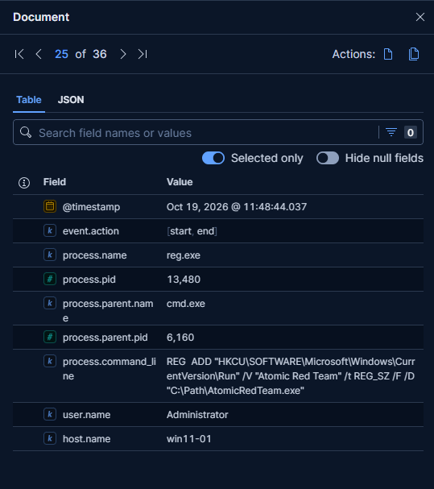
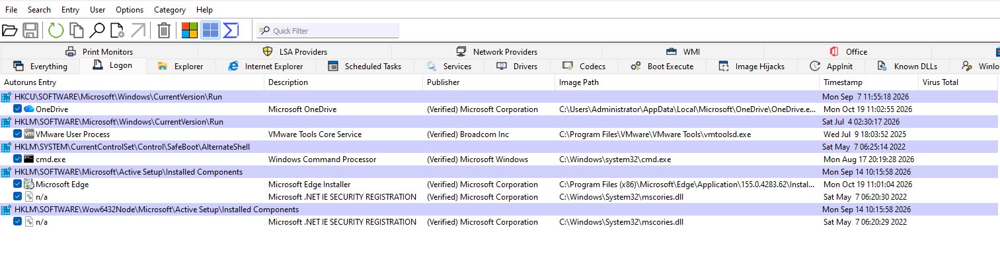
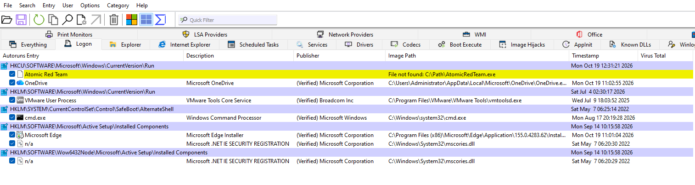

# Incident Report — Run key persistence

| Field | Value |
|---|---|
| **Detection Rule** | Startup or Run Key Registry Modification (elastic rule) |
| **Date/Time** | 2026-10-19, 11:48:43 UTC |
| **Analyst** | Peter Szots |
| **Severity** | Low (payload doesn't exist) |
| **Host** | WIN11-01 (10.10.10.101) |
| **User** | LAB\Administrator |
| **MITRE ATT&CK** | T1547.001 |
| **Verdict** | True Positive (Simulated) |

## Summary

A simulated attack scenario, "run key persistence" has been executed successfully on the WIN11-01 host at 11:48:43 UTC.
The atomic command initially invoked a "cmd.exe" process (PID 6160). This command using the "C:\Path\AtomicRedTeam.exe" payload path then
spawned a new process "reg.exe" (PID 13480) which has created the persistent Registry run key entry.
The entry stayed persistent after the host reboot.

## Investigation Details

**PowerShell process creation - 2 events:**
- Spawn cmd.exe PID 6160 from parent process powershell.exe PID 13044 executing the script block:
*"cmd.exe" /c REG ADD "HKCU\SOFTWARE\Microsoft\Windows\CurrentVersion\Run" /V "Atomic Red Team" /t REG_SZ /F /D "C:\Path\AtomicRedTeam.exe"*
- The script calls reg.exe process (PID 13480) which creates the persistent entry run key named "Atomic Red Team".
*REG ADD "HKCU\SOFTWARE\Microsoft\Windows\CurrentVersion\Run" /V "Atomic Red Team" /t REG_SZ /F /D "C:\Path\AtomicRedTeam.exe"*

## Analysis

The prebuilt Elastic Rule has fired once the Atomic script has been executed on host WIN11-01. It generated 3 alerts pointing at the 
"Atmic Red Team" registry key value. The alert clearly shows the execution chain: powershell.exe → cmd.exe → reg.exe. 
The other 2 alerts shows a new entry in the Sysinternals Autoruns. I have verified manually on host and compared the new Autoruns state with the 
baseline capture that was created before the simulated attack. The log provides clear visibility on the persistency behaviour.

## MITRE ATT&CK Mapping

| Tactic | Technique | ID |
|---|---|---|
| Persistence (TA0003) | Registry Run Keys / Startup Folder | T1547.001 |

## Verdict

**True Positive (Simulated)** — the attack was successfully executed.
Registry write confirmed by Sysmon EID 13 and Elastic Defend; persistence confirmed in Autoruns.

## Recommended Actions

- Remove the "Atomic Red Team" key value from "HKCU\SOFTWARE\Microsoft\Windows\CurrentVersion\Run" and confirm in Autoruns that it is gone.
- Check the Startup folder, scheduled tasks and services for further persistence.

## Screenshots

## Analyst Notes

The payload path (C:\Path\AtomicRedTeam.exe) does not exist, so persistence was established but no malicious execution occurred at logon.
The key is under HKCU, so it only applies to LAB\Administrator logons. The prebuilt rule fired without tuning, and Autoruns provided fast 
host-side confirmation of the Sysmon and Elastic Defend telemetry.
